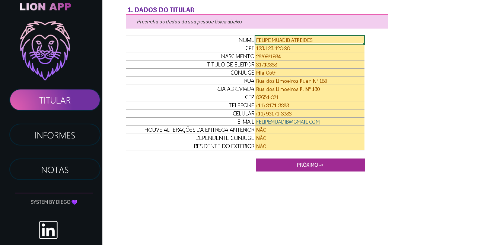
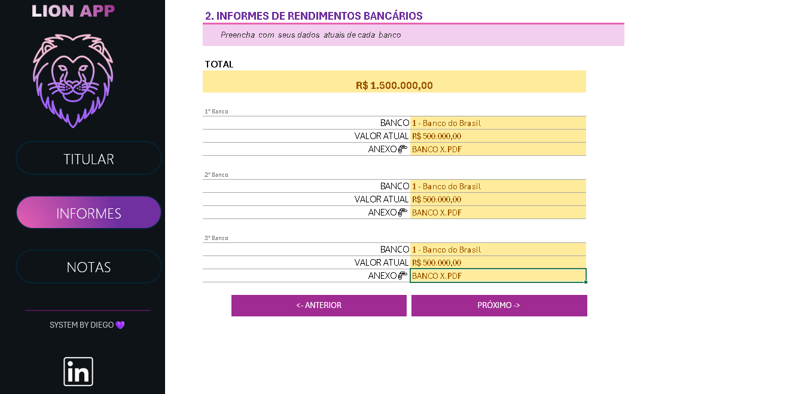
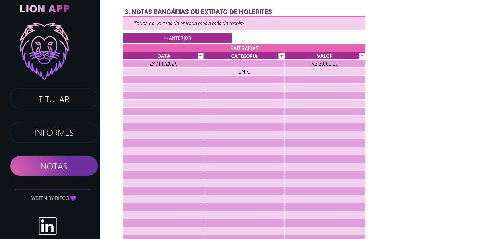

# 🦁 Lion App — Organizador de Declaração de Imposto de Renda no Excel


Ferramenta desenvolvida no **Microsoft Excel** para organizar, validar e centralizar as principais informações necessárias para a Declaração do Imposto de Renda Pessoa Física (IRPF). O projeto foi construído com foco em usabilidade — simulando a experiência de um aplicativo (**Lion App**) com navegação lateral fixa, validações automáticas, máscaras de entrada, alinhamento preciso de ícones via VBA e links rápidos.

Projeto desenvolvido como entrega do desafio prático **"Criando Um Organizador de Declaração de Imposto de Renda"** da **DIO (Digital Innovation One)**.

---

## 📋 Índice

- [Pré-visualização](#-pré-visualização)
- [Funcionalidades Principais](#-funcionalidades-principais)
- [Arquitetura da Planilha](#-arquitetura-da-planilha)
- [Recursos do Excel Aplicados](#-recursos-do-excel-aplicados)
- [Automação de Alinhamento com VBA](#-automação-de-alinhamento-com-vba)
- [Estrutura do Repositório](#-estrutura-do-repositório)
- [Como Utilizar](#-como-utilizar)
- [Possíveis Evoluções](#-possíveis-evoluções)
- [Autor](#-autor)

---

## 📸 Pré-visualização

### 1. Dados do Titular
Cadastro completo de identificação da pessoa física com máscaras personalizadas, validação de campos booleanos e link rápido de e-mail.



### 2. Informes de Rendimentos Bancários
Controle de saldos por instituição financeira com totalizador automático e seleção validada a partir de uma base oculta de bancos brasileiros.



### 3. Notas Bancárias ou Extrato de Holerites
Registro estruturado das entradas mensais categorizadas por origem da receita.



---

## ✨ Funcionalidades Principais

- **Interface em formato de aplicativo (UI/UX no Excel):** Linhas de grade ocultas, zoom padronizado em 85% e menu lateral fixo presente em todas as telas.
- **Alinhamento padronizado por coordenadas (VBA):** Posicionamento exato de ícones e elementos visuais entre as abas utilizando script em VBA, garantindo consistência de layout ao navegar entre telas.
- **Navegação fluida por hiperlinks:** Menu lateral (`TITULAR`, `INFORMES`, `NOTAS`) e botões de fluxo sequencial (`PRÓXIMO ->` e `<- ANTERIOR`) integrados entre as planilhas.
- **Links rápidos:** Ação `mailto:` configurada no campo de e-mail do titular (com assunto pré-preenchido) e atalho direto no ícone de perfil para o LinkedIn do autor.
- **Validação de dados com tratamento de erros:** Listas suspensas que impedem entradas inconsistentes, incluindo mensagens orientativas ao selecionar a célula e alertas de erro personalizados.
- **Base de apoio oculta:** Planilha dedicada (`TABELAS`) mantida oculta para preservar a limpeza visual enquanto alimenta a seleção de bancos.

---

## 🗂️ Arquitetura da Planilha

O arquivo `organizador-imposto-de-renda.xlsx` é composto por **4 planilhas** (3 visíveis e 1 oculta):

| Planilha | Visibilidade | Função | Principais Recursos |
| :--- | :--- | :--- | :--- |
| **`TITULAR`** | Visível | Cadastro de dados cadastrais e fiscais do contribuinte (Nome, CPF, Nascimento, Título de Eleitor, Cônjuge, Endereço, Contatos e Declarações). | Máscaras personalizadas (CPF, CEP, Telefone, Celular), validação `SIM/NÃO` (`D17:D19`) e link `mailto:` (`D16`). |
| **`INFORMES`** | Visível | Consolidação de rendimentos/saldos de até 3 instituições financeiras e referência aos arquivos de informes (PDF). | Soma automática `=SOMA(D11;D16;D21)` em `C7`, validação cruzada ligada à aba `TABELAS` em `D10`, `D15` e `D20`. |
| **`NOTAS`** | Visível | Registro cronológico de entradas mensais (notas fiscais, holerites e receitas avulsas). | Tabela estruturada (`Tabela1`, `C8:E35`) com filtro automático e lista suspensa (`HOLERITE`, `CNPJ`, `FREELANCE`) em `D9:D35`. |
| **`TABELAS`** | **Oculta** | Base de apoio com os códigos e nomes de **50 instituições financeiras brasileiras** (`A2:A51`), como Banco do Brasil (1), Caixa (104), Bradesco (237), Nubank (260), Itaú (341), BTG Pactual (208), C6 Bank (336) e Banco Inter (77). | Fonte oficial da validação de dados da aba `INFORMES` (`TABELAS!$A$2:$A$51`). |

---

## 🛠️ Recursos do Excel Aplicados

- **Fórmulas e Agregação:** `SOMA` para consolidar os valores declarados nos informes bancários.
- **Formatação Personalizada de Números:**
  - **CPF:** `000"."000"."000"-"00`
  - **CEP:** `00000\-000`
  - **Telefone Fixo:** `"("00")"\ 0000"-"0000`
  - **Celular:** `"("00")"\ 00000"-"0000`
  - **Moeda Brasileira:** `"R$"\ #,##0.00`
- **Validação de Dados:**
  - Listas fixas (`SIM,NÃO` e `HOLERITE,CNPJ,FREELANCE`).
  - Lista dinâmica entre abas (`TABELAS!$A$2:$A$51`) com **Mensagem de Entrada** (*"Informe um banco vinculado ao seu CPF"*) e **Alerta de Erro** (*"Banco não encontrado — Informe um banco da lista"*).
- **Tabelas Estruturadas:** Uso de `Tabela1` na aba `NOTAS` com estilo personalizado (`TableStyleMedium13`), linhas zebradas e autofiltro.
- **Formas e Hiperlinks Internos/Externos:** Botões estilizados vinculados às células de destino (`#TITULAR!C1`, `#INFORMES!C1`, `#NOTAS!C1`) e links externos.

---

## ⚙️ Automação de Alinhamento com VBA

Para garantir que os ícones e elementos de interface ficassem perfeitamente centralizados e alinhados nas mesmas coordenadas em todas as abas da planilha, foi utilizado o seguinte script em **VBA (Visual Basic for Applications)** durante a construção do layout:

```vba
Sub MoverIconeParaPosicao()
    Dim shp As Shape
    Dim ws As Worksheet
    Dim nomeIconeProcurado As String
    Dim novaPosicaoX As Double
    Dim novaPosicaoY As Double
    
    ' Defina a planilha atual
    Set ws = ActiveSheet
    
    ' Defina o nome do ícone que você quer mover (exato, como aparece no Excel)
    nomeIconeProcurado = "Ícone 1" ' <-- Troque aqui pelo nome do seu ícone
    
    ' Defina a posição desejada
    novaPosicaoX = 100 ' Posição X em pontos
    novaPosicaoY = 50  ' Posição Y em pontos
    
    ' Procura pelo ícone na planilha
    For Each shp In ws.Shapes
        If shp.Name = nomeIconeProcurado Then
            ' Move o ícone para a nova posição
            shp.Left = novaPosicaoX
            shp.Top = novaPosicaoY
            MsgBox "Ícone '" & nomeIconeProcurado & "' movido com sucesso!", vbInformation
            Exit Sub
        End If
    Next shp
    
    ' Se não encontrar
    MsgBox "Ícone '" & nomeIconeProcurado & "' não encontrado.", vbExclamation
End Sub
```

> **Nota:** Após concluir o posicionamento preciso dos elementos visuais, a pasta de trabalho foi salva no formato padrão `.xlsx` (sem macros incorporadas), garantindo abertura segura e compatibilidade imediata para qualquer usuário.

---

## 📁 Estrutura do Repositório

```text
organizador-declaracao-imposto-renda-excel/
├── assets/
│   ├── lionapp-titular.png
│   ├── lionapp-informes.png
│   └── lionapp-notas.png
├── organizador-imposto-de-renda.xlsx
└── README.md
```

---

## 🚀 Como Utilizar

1. Faça o download ou clone este repositório:

```bash
git clone https://github.com/diegofloriano/organizador-declaracao-imposto-renda-excel.git
```

2. Abra o arquivo `organizador-imposto-de-renda.xlsx` no **Microsoft Excel** (recomendado para manter todas as validações cruzadas, fontes e botões de navegação).
3. Na aba **TITULAR**, substitua os dados fictícios pelos seus dados reais.
4. Use o menu lateral ou o botão **PRÓXIMO ->** para ir até **INFORMES**, escolha seus bancos na lista suspensa, informe os valores atuais e vincule os arquivos PDF dos informes de rendimento.
5. Avance para **NOTAS** e registre suas entradas mensais selecionando a categoria correspondente (`HOLERITE`, `CNPJ` ou `FREELANCE`).
6. *(Opcional)* Para visualizar ou expandir a lista de bancos cadastrados, clique com o botão direito sobre a barra de guias no Excel e selecione **Reexibir → `TABELAS`**.

---

## 🔮 Possíveis Evoluções

- [ ] Adicionar linha de totais e consolidação por categoria (`SOMASE`) na aba `NOTAS`.
- [ ] Incluir gráfico de distribuição de receitas por categoria (`HOLERITE`, `CNPJ`, `FREELANCE`).
- [ ] Adicionar aba dedicada a **Despesas Dedutíveis** (saúde, educação, previdência privada e dependentes).
- [ ] Automatizar a abreviação de logradouros no campo `RUA ABREVIADA` via fórmula `SUBSTITUIR`.

---

## 👤 Autor

Desenvolvido por **Diego Floriano Costa** como parte dos estudos práticos na **Digital Innovation One (DIO)**.

[](https://github.com/diegofloriano)
[](https://www.linkedin.com/in/diego-floriano/)